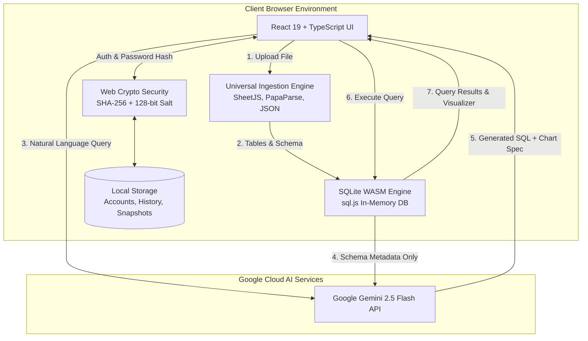

# BolDB: Autonomous AI-Powered In-Browser Database Studio
## Comprehensive Project Architecture, Technical Deep-Dive & Viva Presentation Guide

---

## Slide 1: Project Overview & Executive Summary

### What is BolDB?
**BolDB** is a zero-latency, privacy-first **Autonomous Database Studio** running entirely in the client's browser. It allows technical and non-technical users to load arbitrary data files (Excel, CSV, JSON, SQLite, SQL dumps), converse with their data using natural language, execute optimized SQL queries instantly, and visualize trends through dynamic charts.

### The Problem It Solves
1. **The SQL Barrier**: Business users and analysts often cannot write multi-table SQL joins, group-by aggregations, or subqueries.
2. **Server Infrastructure Overhead**: Traditional database tools require provisioning backend servers, Docker containers, remote databases, and managing network latency.
3. **Data Privacy & Compliance**: Organizations cannot upload sensitive internal datasets or customer data to third-party database servers.
4. **Credential Security**: Weak authentication systems store plain-text or poorly hashed passwords susceptible to pre-computed rainbow table attacks.

### The BolDB Solution
- **Client-Side In-Memory Database**: Powered by **SQLite compiled to WebAssembly (sql.js)**. 100% of the dataset and query engine runs inside the browser tab with 0ms server latency.
- **Natural Language to SQL**: Converts natural language prompts into production-grade SQL using **Google Gemini 2.5 Flash**.
- **Automated Query Self-Healing**: Automatically catches runtime SQL errors and feeds the diagnostics back to the LLM to autonomously correct the query.
- **Cryptographic Hashing for Auth**: Passwords are never stored in raw text; they are secured using **SHA-256 with 128-bit cryptographically secure random salts** via the native browser **Web Crypto API**.
- **Zero Server Uploads**: Only sanitized schema headers (table and column names) are sent to Gemini—**zero raw data rows ever leave the client's machine**.

---

## Slide 2: High-Level Architecture & Tech Stack



### Complete Technology Stack
| Layer | Technology | Purpose |
| :--- | :--- | :--- |
| **UI Framework** | **React 19 + TypeScript** | Modern component architecture, strict typing, responsive state management |
| **Build Tool** | **Vite** | Fast Hot Module Replacement (HMR) and optimized ES module bundling |
| **Relational Database** | **SQLite WebAssembly (`sql.js`)** | Full ACID-compliant SQL engine running directly in browser memory |
| **Generative AI** | **Google Gemini 2.5 Flash** | Contextual natural language to SQL translation & automated query repair |
| **Cryptographic Security** | **Web Crypto API (`window.crypto.subtle`)** | Hardware-accelerated SHA-256 hashing and CSPRNG salting for passwords |
| **Spreadsheet Parsing** | **SheetJS (`xlsx`)** | Binary parsing of `.xlsx`, `.xlsm`, and `.xls` multi-sheet workbooks |
| **CSV / Delimited Data** | **PapaParse** | High-performance client-side CSV and TSV parsing with type deduction |
| **Visualizations** | **Recharts** | Declarative Bar, Line, Area, and Pie chart rendering |
| **Iconography** | **Lucide React** | Modern, lightweight SVG iconography |

---

## Slide 3: In-Browser SQLite WebAssembly (How sql.js Works)

### Traditional Database vs. BolDB SQLite WASM
- **Traditional**: Browser $\xrightarrow{\text{HTTP Request (50-200ms)}}$ Backend Server $\xrightarrow{\text{TCP}}$ Database Server (MySQL/PostgreSQL) $\rightarrow$ Returns rows over internet.
- **BolDB**: Browser tab initializes an in-memory SQLite virtual machine using WebAssembly. All disk reads and writes occur inside a typed array buffer (`Uint8Array`) in the browser's allocated RAM. **Execution latency is 0.1ms to 2ms.**

### Database Lifecycle in `src/services/sqliteService.ts`
1. **WASM Initialization**:
   `initSqlJs()` loads the compiled WebAssembly binary into the browser's execution thread.
2. **Virtual Database Creation**:
   `this.db = new this.SQL.Database()` allocates a private virtual SQLite file system in client RAM.
3. **Execution**:
   Queries are sent to `this.db.exec(sql)`. If multiple statements exist, `exec` executes them in transactional sequence.
4. **Schema Introspection**:
   The engine retrieves table structures using SQLite pragma statements:
   ```sql
   SELECT name FROM sqlite_master WHERE type='table' AND name NOT LIKE 'sqlite_%';
   PRAGMA table_info("table_name");
   ```
5. **Mutation & Rollback**:
   When a user edits any cell in the Data Grid, an `UPDATE` statement is executed. A pre-mutation snapshot is preserved, allowing 1-click instantaneous rollback.

---

## Slide 4: Universal File Ingestion Engine

BolDB can ingest 6 different file formats and transform them into relational tables:

```
[Raw File Drop] ───► Ingestion Router (sqliteService.ts)
                          │
                          ├─► .xlsx / .xlsm ──► SheetJS ──► Multiple Tables (1 per sheet)
                          ├─► .csv / .tsv   ──► PapaParse ─► Single Relational Table
                          ├─► .json         ──► Object Parser ──► Normalized Relational Table
                          ├─► .sqlite / .db ──► Uint8Array Buffer ──► Native Database Mount
                          └─► .sql          ──► Lexer/Parser ──► In-Memory Script Execution
```

### Automatic Type Deduction
When importing unstructured CSV or Excel data, BolDB inspects the first 100 rows to automatically deduce SQL column data types:
- Matches integer regex (`/^-?\d+$/`) $\rightarrow$ `INTEGER`
- Matches float regex (`/^-?\d+\.\d+$/`) $\rightarrow$ `REAL`
- Matches ISO date format $\rightarrow$ `DATE`
- Default fallback $\rightarrow$ `TEXT`

---

## Slide 5: Natural Language to SQL AI Pipeline (Gemini Integration)

### Grounding & Privacy Preservation
To guarantee complete user privacy, BolDB **never** transmits raw dataset rows to Google Gemini. 
Instead, it builds a lightweight **Schema Context** containing:
- Table names
- Column names & data types (e.g., `id INTEGER PRIMARY KEY`, `total_amount REAL`)
- Row counts

```
Schema Context (Table names & Columns only)
              +
User Natural Language Question ("Show top 5 customers by spend")
              +
System Instructions (Strict SQLite dialect, safety guards)
              │
              ▼
   [Google Gemini 2.5 Flash]
              │
              ▼
Structured JSON Response:
{
  "sql": "SELECT c.name, SUM(o.total_amount) as total_spent FROM customers c ...",
  "explanation": "Aggregating order amounts by customer and sorting descending.",
  "chartRecommendation": "bar"
}
```

### Automated Query Self-Healing (Error Recovery)
If an AI-generated query triggers an execution error (e.g. unknown column or syntax error):
1. The error message is caught in the `executeQuery` try/catch block.
2. BolDB immediately triggers `repairQuery(failedSql, errorMessage, schemaContext)`.
3. Gemini analyzes the exact error message and active schema, repairs the query, and executes the corrected version automatically.

---

## Slide 6: Cryptographic Hashing in Authentication (Sign In & Sign Up)

### How Hashing Works in BolDB
In `src/services/authService.ts`, authentication security is implemented using the W3C standard **Web Crypto API** (`window.crypto.subtle`).

```
                    ┌─────────────────────────┐
                    │ User Enters Password    │
                    └───────────┬─────────────┘
                                │
                                ▼
                    ┌─────────────────────────┐
                    │ Generate 128-bit Salt   │ (crypto.getRandomValues)
                    │ (Random 32-char Hex)    │
                    └───────────┬─────────────┘
                                │
                                ▼
                    ┌─────────────────────────┐
                    │ Salt + ":" + Password   │
                    └───────────┬─────────────┘
                                │
                                ▼
                    ┌─────────────────────────┐
                    │ SHA-256 Digest Function │ (crypto.subtle.digest)
                    └───────────┬─────────────┘
                                │
                                ▼
                    ┌─────────────────────────┐
                    │ 64-character Hex Hash   │
                    └───────────┬─────────────┘
                                │
                ┌───────────────┴───────────────┐
                ▼                               ▼
       [Registration / Sign Up]         [Verification / Sign In]
   Store (Salt + PasswordHash)      Hash(Input + Stored Salt) == StoredHash
```

### The Three Cryptographic Functions in `authService.ts`:

#### 1. Salt Generation: `generateSalt(byteLength = 16)`
```typescript
export function generateSalt(byteLength: number = 16): string {
  const array = new Uint8Array(byteLength);
  window.crypto.getRandomValues(array);
  return Array.from(array)
    .map((b) => b.toString(16).padStart(2, '0'))
    .join('');
}
```
*Why it matters:* Uses a Cryptographically Secure Pseudo-Random Number Generator (CSPRNG) to generate an unpredictable 128-bit value.

#### 2. Salted SHA-256 Hashing: `hashPassword(password, salt)`
```typescript
export async function hashPassword(password: string, salt: string): Promise<string> {
  const encoder = new TextEncoder();
  const data = encoder.encode(`${salt}:${password}`);
  const hashBuffer = await window.crypto.subtle.digest('SHA-256', data);
  const hashArray = Array.from(new Uint8Array(hashBuffer));
  return hashArray.map((b) => b.toString(16).padStart(2, '0')).join('');
}
```
*Why it matters:* A one-way cryptographic hash with pre-image resistance. Even if two users choose the exact same password, their unique salts produce completely distinct hash digests, neutralizing rainbow table attacks.

#### 3. Verification: `verifyPassword(password, storedHash, salt)`
```typescript
export async function verifyPassword(password: string, storedHash: string, salt: string): Promise<boolean> {
  if (!password || !storedHash || !salt) return false;
  const computedHash = await hashPassword(password, salt);
  return computedHash === storedHash;
}
```
*Why it matters:* Recomputes the hash using the stored salt and tests for mathematical equality without ever exposing the password.

---

## Slide 7: UI & Visualization Highlights

1. **Indian Rupee (₹) Currency Adaptation**:
   - The interactive landing page and demo metrics are formatted in Indian Rupees (₹), presenting clear, localized financial indicators for customers and revenue aggregations.
2. **Interactive 3D Particle Sphere**:
   - Canvas-rendered spherical particle field with depth-based opacity and dynamic rotation.
3. **Data Grid with Cell Mutation**:
   - Interactive tabular view featuring double-click in-place editing, CSV export, and pagination.
4. **Visualizer Engine**:
   - Automatically inspects query result sets. If aggregations or category counts are detected, it recommends and renders an interactive Bar, Line, Area, or Pie chart via Recharts.

---

## Slide 8: Professor Defense & Viva Q&A Guide

### Q1: "Where is the database hosted? Is there a backend server running SQLite or PostgreSQL?"
> **Answer**: 
> "No backend database server is required. BolDB runs **SQLite compiled to WebAssembly (WASM)** directly in the browser's JavaScript runtime using the `sql.js` library. The database file exists as a binary byte array in the browser tab's allocated memory. This delivers sub-millisecond query execution with zero network round trips and zero hosting costs."

---

### Q2: "How do you ensure data privacy when you send queries to Google Gemini?"
> **Answer**: 
> "BolDB implements strict **Schema-Only Context Grounding**. When generating SQL, the application extracts only table names, column names, and column data types using SQLite `PRAGMA table_info`. **No row data, customer records, or financial figures are ever sent to Gemini**. The LLM generates the SQL based solely on the schema structure, and the resulting query is executed locally inside the browser."

---

### Q3: "Why did you use SHA-256 with a salt instead of plain SHA-256 or MD5?"
> **Answer**: 
> "MD5 is cryptographically broken and vulnerable to collision attacks. Plain SHA-256 without a salt is vulnerable to **Rainbow Table attacks**—attackers can look up pre-computed hash tables to reverse passwords in seconds.
> In BolDB, we generate a unique **128-bit cryptographically secure random salt** for each account using `window.crypto.getRandomValues`. When the salt is combined with the password before hashing, identical passwords produce completely different 64-character hashes, making rainbow tables and dictionary attacks mathematically infeasible."

---

### Q4: "What happens if Gemini hallucinates an invalid SQL query?"
> **Answer**: 
> "BolDB features an **Automated Query Self-Healing Pipeline**. When the local SQLite engine encounters an error (e.g. `no such column` or syntax error), the application catches the exact SQLite runtime error. It then automatically calls Gemini's repair endpoint, passing the original prompt, the failed SQL, the exact error message, and the schema context. Gemini diagnoses its own mistake and produces a corrected SQL query without requiring user intervention."

---

### Q5: "How does the system handle Excel workbooks with multiple sheets?"
> **Answer**: 
> "We use **SheetJS (`xlsx`)** to read the workbook binary buffer. For each sheet within the workbook, BolDB iterates over the rows, performs automatic column data type inference (identifying integers, floats, dates, and strings), and creates a distinct relational table named after the sheet in the SQLite database. Foreign keys and multi-sheet joins can then be executed across all sheets in the workbook."

---

## Slide 9: Summary & Future Enhancements

- **Current Capabilities**: In-browser SQLite WASM, Google Gemini 2.5 AI Natural Language Querying, Universal Ingestion (Excel, CSV, JSON, SQLite), SHA-256 + Salted Authentication, Dynamic Recharts Visualizations, Rupee (₹) demo currency, and single-click Rollback.
- **Future Roadmap**:
  1. WebAssembly IndexedDB persistence (preserving databases across browser sessions).
  2. Local WebGPU / ONNX LLM execution for 100% offline AI querying.
  3. Collaborative multi-user peer-to-peer query sharing via WebRTC.
